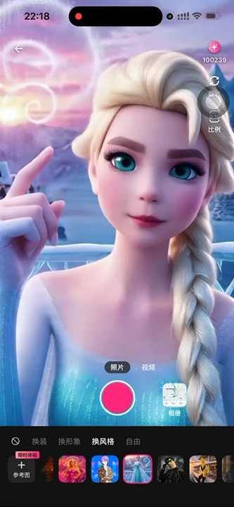
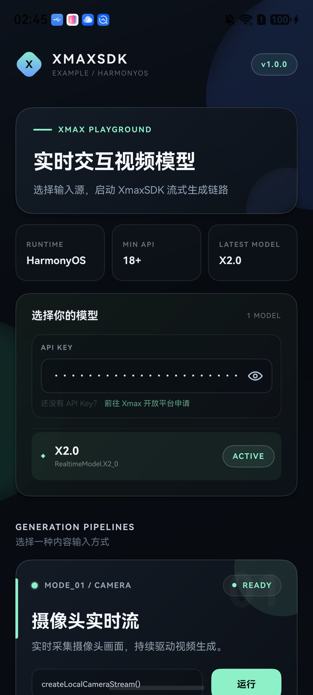
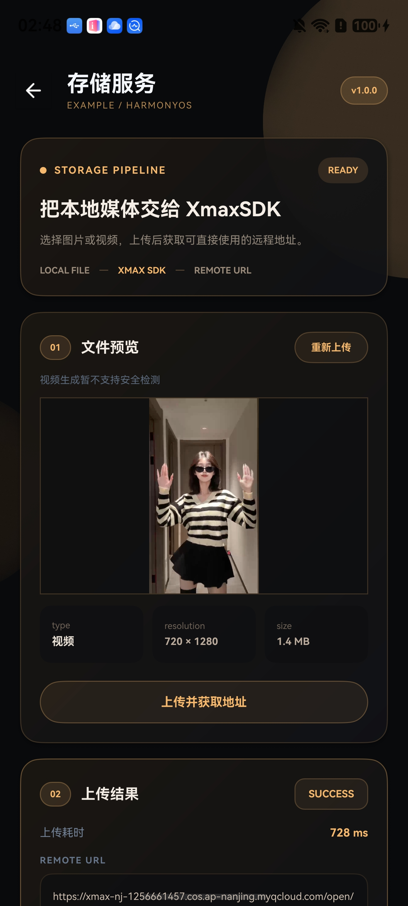

<p align="center">
  
</p>

<p align="center">
  <a href="https://developer.huawei.com/consumer/en/"></a>
  <a href="https://developer.huawei.com/consumer/en/arkts/"></a>
  <a href="https://platform.xmaxai.com/"></a>
  <a href="./LICENSE"></a>
</p>

We introduce XmaxSDK, a native HarmonyOS SDK designed for real-time interactive video generation via Xmax models. XmaxSDK implements an end-to-end pipeline covering media acquisition, video streaming, frame-by-frame generation, and on-device rendering, enabling developers to seamlessly integrate low-latency, high-fidelity video transformations into creative applications at a much lower cost than alternative solutions.

<p align="center"></p>

<br>

## What you can build with XmaxSDK

<table>
  <tr>
    <th width="24%" align="left">Realtime Use Case</th>
    <th width="60%" align="left">Description</th>
    <th width="16%" align="center">Demo</th>
  </tr>
  <tr>
    <td rowspan="2" width="24%" valign="middle">
      <strong>Character Swapping</strong>
    </td>
    <td width="60%" valign="middle">
      Replace anyone in your live feed with a designated avatar in real-time.
    </td>
    <td rowspan="2" width="16%" align="center" valign="middle">
      <a href="./materials/videos/use-cases/character-swapping.mp4">
        
        <br>
        <sub>▶ Play demo</sub>
      </a>
    </td>
  </tr>
  <tr>
    <td width="60%" valign="middle">
      <strong>Prompt:</strong> <code>视频中角色替换成参考图中角色</code>
      <br><br>
      <strong>Reference image:</strong> Select a clear image of the desired character with a clean background.
    </td>
  </tr>
  <tr>
    <td rowspan="2" width="24%" valign="middle">
      <strong>Virtual Try-On</strong>
    </td>
    <td width="60%" valign="middle">
      Seamlessly change outfits, preserving exact body shape, natural motion, and an
      authentic fit.
    </td>
    <td rowspan="2" width="16%" align="center" valign="middle">
      <a href="./materials/videos/use-cases/virtual-try-on.mp4">
        
        <br>
        <sub>▶ Play demo</sub>
      </a>
    </td>
  </tr>
  <tr>
    <td width="60%" valign="middle">
      <strong>Prompt:</strong> <code>视频中人物衣服替换成参考图中衣服</code>
      <br><br>
      <strong>Reference image:</strong> Select a clear image of the target outfit with a clean background.
    </td>
  </tr>
  <tr>
    <td rowspan="2" width="24%" valign="middle">
      <strong>Video Restyling</strong>
    </td>
    <td width="60%" valign="middle">
      Reimagine your world in any style with an immersive visual experience.
    </td>
    <td rowspan="2" width="16%" align="center" valign="middle">
      <a href="./materials/videos/use-cases/video-restyling.mp4">
        
        <br>
        <sub>▶ Play demo</sub>
      </a>
    </td>
  </tr>
  <tr>
    <td width="60%" valign="middle">
      <strong>Prompt:</strong> <code>视频风格变为参考图指定的风格</code>
      <br><br>
      <strong>Reference image:</strong> Select an image that captures the artistic style you want to apply.
    </td>
  </tr>
  <tr>
    <td rowspan="2" width="24%" valign="middle">
      <strong>AI Companions</strong>
    </td>
    <td width="60%" valign="middle">
      Summon virtual characters into your live camera feed and interact with them
      through gestures.
    </td>
    <td rowspan="2" width="16%" align="center" valign="middle">
      <a href="./materials/videos/use-cases/ai-companions.mp4">
        
        <br>
        <sub>▶ Play demo</sub>
      </a>
    </td>
  </tr>
  <tr>
    <td width="60%" valign="middle">
      <strong>Prompt:</strong> <code>指定角色在场景中互动</code>
      <br><br>
      <strong>Reference image:</strong> Select a clear image of the virtual character you want to summon with a clean background.
    </td>
  </tr>
  <tr>
    <td rowspan="2" width="24%" valign="middle">
      <strong>Live Photo</strong>
    </td>
    <td width="60%" valign="middle">
      Animate and control characters in your images simply by drawing motion
      trajectories.
    </td>
    <td rowspan="2" width="16%" align="center" valign="middle">
      <a href="./materials/videos/use-cases/live-photo.mp4">
        
        <br>
        <sub>▶ Play demo</sub>
      </a>
    </td>
  </tr>
  <tr>
    <td width="60%" valign="middle">
      <strong>Prompt:</strong> <code>让画面自然动起来</code>
      <br><br>
      <strong>Reference image:</strong> Use the input image as the reference
    </td>
  </tr>
</table>

<br>

## Why XmaxSDK?

<table>
  <thead>
    <tr>
      <th height="104" align="center" valign="middle">
        <br>Low latency
      </th>
      <th height="104" align="center" valign="middle">
        <br>Cost efficiency
      </th>
      <th height="104" align="center" valign="middle">
        <br>High fidelity
      </th>
    </tr>
  </thead>
  <tbody>
    <tr>
      <td>End-to-end latency is measured in , ensuring that updates to generation conditions and interaction controls are reflected instantly.</td>
      <td>Run on a , reducing inference costs by orders of magnitude versus datacenter GPUs like H100.</td>
      <td>Our models support real-time generation at up to , delivering production-ready, high-quality video output.</td>
    </tr>
  </tbody>
</table>

<br>

## Prerequisites

- HarmonyOS 5.1.0 (API 18) or later
- An Xmax API key from the [Xmax Platform](https://platform.xmaxai.com/api-keys)

> [!WARNING]
> Do not commit an Xmax API key to version control. Supply credentials securely at
> runtime, or use a temporary key issued by the Xmax API. See
> [Authentication](https://platform.xmaxai.com/docs/authentication) for details.

<br>

## Installation

The current release is distributed as a Harmony Archive (HAR). XmaxSDK depends on
the VolcEngine RTC SDK for HarmonyOS, which is not currently available through the
official OHPM Registry; both archives must therefore be integrated manually.

Download the following files:

- [`xmaxsdk-1.0.13.har`](https://github.com/Xmax-AI/XmaxSDK-HarmonyOS/releases/download/1.0.13/xmaxsdk-1.0.13.har)
  from the XmaxSDK GitHub Release
- The VolcEngine RTC HAR from the
  [HarmonyOS integration guide](https://bytedance.larkoffice.com/docx/VCVzduvzioORCixDKzEcMt9Fnof?from=from_copylink)

Add both files to the application module's `libs` directory:

```text
entry/libs/xmaxsdk-1.0.13.har
entry/libs/VolcEngineRTCToB-Release.har
```

Declare XmaxSDK in the module-level `oh-package.json5`:

```json5
{
  "dependencies": {
    "@xmax/sdk": "file:./libs/xmaxsdk-1.0.13.har"
  }
}
```

Override the VolcEngine dependency in the project-level `oh-package.json5`:

```json5
{
  "modelVersion": "6.1.1",
  "dependencies": {},
  "devDependencies": {},
  "overrides": {
    "@bytertc/volcenginertc": "file:./entry/libs/VolcEngineRTCToB-Release.har"
  }
}
```

Install the dependencies:

```bash
ohpm install
```

See [Configure permissions](./materials/usage.md#configure-permissions) before creating
a local media stream.

<br>

## Quick Start

Use your front camera to turn yourself into a character from a reference image in real time.

```ts
import { common } from '@kit.AbilityKit'
import {
  RealtimeConfiguration, RealtimeContext, RealtimeModel, RealtimeModels,
  RealtimeVideoTrack, XmaxClient, XmaxConfiguration, XmaxEnvironment,
  XmaxRealtimeDualVideo
} from '@xmax/sdk'

// Initialize the client
const context = this.getUIContext().getHostContext() as common.UIAbilityContext
const client = new XmaxClient(
  new XmaxConfiguration('<YOUR_XMAX_API_KEY>', XmaxEnvironment.GLOBAL),
  context
)

// Initialize the realtime manager
const realtime = client.createRealtimeManager(
  new RealtimeConfiguration(RealtimeModels.realtime(RealtimeModel.X2_1))
)

// Create the video view
// Declare state in the page component and call videoPreview() from build()
@State localTrack?: RealtimeVideoTrack = undefined
@State remoteTrack?: RealtimeVideoTrack = undefined

@Builder
videoPreview() {
  XmaxRealtimeDualVideo({ localTrack: this.localTrack, remoteTrack: this.remoteTrack })
    .width('100%')
    .height('100%')
}

// Create a camera stream and bind the preview
const localStream = await realtime.createLocalCameraStream()
this.localTrack = localStream.videoTrack

// Once the preview is ready, start generation and display the result
const remoteStream = await realtime.startGeneration(
  localStream,
  new RealtimeContext("视频中角色替换成参考图中角色", "https://cdn.xmax.ai/images/playground/charx/charx_image1.png?v=26&presetVersion=20261022")
)
this.remoteTrack = remoteStream.videoTrack

// Run the following when generation is no longer needed
await realtime.close()
```

<br>

## Example Project

A complete example application featuring an ArkUI implementation
is available in [`examples/XLab`](https://github.com/Xmax-AI/XmaxSDK-HarmonyOS/tree/main/examples/XLab).
It demonstrates real-time generation using live camera feeds, static images, and
local video files.

<p align="center"></p>

<br>

## Dependencies

- <ins><strong>VolcEngine RTC SDK</strong></ins> enables low-latency, real-time audio and video communication.
- <ins><strong>Tencent Cloud COS SDK</strong></ins> handles media upload and download via object storage.

<br>

## Contact us

For bug reports and feature requests, please open a
[GitHub Issue](https://github.com/Xmax-AI/XmaxSDK-HarmonyOS/issues). For integration
assistance and technical support, contact us at [sdk@xmax.ai](mailto:sdk@xmax.ai).

<br>

## License

XmaxSDK is available under the terms of the [MIT License](LICENSE).
